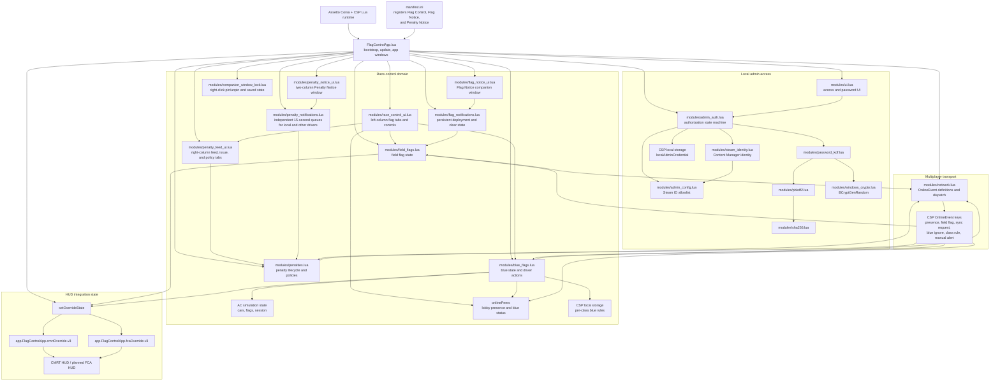

# FlagControlApp Knowledge Graph

This graph documents the current source-level relationships between the app's runtime, modules, shared state, network events, persistence, and tests. It describes client-side behavior; it is not a security or multiplayer authorization model.

Current release: **0.5.0**. The ready-to-install package is `releases/FlagControlApp-v0.5.0.zip`.

## Runtime and module graph

## Principal flows

### Local admin authorization

1. `admin_auth` loads the allowlist through `admin_config` and reads the local Content Manager Steam identity through `steam_identity`.
2. The identity must parse as one valid SteamID64 and match the allowlist; otherwise the local controls remain locked.
3. Password setup, verification, change, and reset are exposed to `ui` through injected callbacks. The verifier is held in CSP local storage, not in the tracked allowlist example.
4. `password_kdf` produces or verifies the PBKDF2-HMAC-SHA256 credential. It uses `pbkdf2` and `sha256`; new salts come from the Windows BCrypt random source.
5. `FlagControlApp.lua` passes `admin_auth.isUnlocked()` to the local field-flag and blue-flag action modules.

### Field and blue flag control

- `field_flags` validates the supported field values (none, green, yellow, red), tracks the current sender, updates override state, and publishes accepted local changes.
- `blue_flags` collects driver state from the simulation and online peer heartbeats. It identifies blue status from native AC flags, peer presence, automatic lapping/traffic checks, or manual class-group alerts.
- Blue ignore, class-rule, and manual-alert actions update local state and publish through `network`; class rules are persisted per class in CSP storage.
- `race_control_ui` reads the domain modules and turns UI actions into their public methods. The bootstrap updates auth and presence, requests a field-flag snapshot on joining an online race, sends presence every two seconds, and expires peers after seven seconds.

### Network and trust boundary

| OnlineEvent key | Protocol | Main payload / purpose | Receiver applies |
|---|---:|---|---|
| `app.FlagControlApp.lobbyPresence.v4` | 4 | Class and blue-status heartbeat | Peer record; may trigger a field-state snapshot |
| `app.FlagControlApp.fieldFlag.v6` | 6 | Active flag and flag value | `field_flags.apply` |
| `app.FlagControlApp.fieldFlagSyncRequest.v1` | 1 | Request current field state | Unlocked sender replies with a snapshot |
| `app.FlagControlApp.blueIgnore.v3` | 3 | Driver identity and ignored state | `blue_flags.applyIgnore` |
| `app.FlagControlApp.blueClassRule.v1` | 1 | Class, group, and automatic-blue setting | `blue_flags.applyBlueClassRule` |
| `app.FlagControlApp.manualBlueAlert.v1` | 1 | Active state and group | `blue_flags.applyAlert` |
| `app.FlagControlApp.penaltyFeedMeta.v1` | 1 | Compact penalty metadata and sync requests | `penalties` record apply method |
| `app.FlagControlApp.penaltyFeedText.v1` | 1 | Driver, cause, details, and issuer text fields | Completes the matching penalty record |

The local admin gate protects local UI/action entry points. The network callbacks validate sender presence, protocol, and selected payload fields, but do not require the remote sender to be an unlocked admin. Treat received lobby events as untrusted client messages.

The Penalty Feed currently supports manual assignment and policy configuration, but no incident detectors are connected in this client-only release. DQ messages do not kick a driver; any future server-admin credentials must remain server-side.

## State and persistence relationships

| State or data | Owner | Used by |
|---|---|---|
| Current field flag and sender | `field_flags` | Race-control UI, network sync, shared override state |
| Current flag notice | `modules/flag_notifications.lua` | Flag Notice companion window until the next flag update |
| Per-driver ignore state | `blue_flags` | Blue tab, local native-flag suppression, peer updates |
| Class blue group and auto-blue preference | `blue_flags` + CSP storage | Blue detection and manual group alerts |
| Peer heartbeat and reported blue state | `network` / bootstrap-owned `onlinePeers` | Blue detection, lobby driver list, reconnect sync |
| Penalty records | `modules/penalties.lua` + CSP storage | Right-column feed and lobby synchronization |
| Active penalty notices | `modules/penalty_notifications.lua` | Separate local and other-driver columns for 15 seconds per issue |
| Per-source penalty policies | `modules/penalties.lua` + local CSP storage | Steward's automatic-policy configuration |
| Local admin credential verifier | CSP storage key `localAdminCredential` | `admin_auth` |
| Admin Steam ID allowlist | Local INI file via `admin_config` | `admin_auth` authorization checks |
| Local Steam identity | Content Manager `Values.data` via `steam_identity` | `admin_auth` authorization checks |
| HUD override fields | Shared memory under CMRT and FCA keys | CMRT HUD and planned FCA HUD |

The two shared-memory keys mirror app-controlled state for compatibility. The local class is read from the FCA key first and falls back to the CMRT key.

## Module and test index

| Implementation node | Responsibility | Focused test |
|---|---|---|
| `FlagControlApp.lua` | Bootstrap and wire runtime modules | `tests/ui_test.lua` exercises UI callbacks; no standalone bootstrap test |
| `modules/admin_auth.lua` | Allowlist-gated setup, login, reset, change, cooldown | `tests/admin_auth_test.lua` |
| `modules/admin_config.lua` | Parse and load allowlist | `tests/admin_config_test.lua` |
| `modules/steam_identity.lua` | Parse and read Content Manager identity | `tests/steam_identity_test.lua` |
| `modules/password_kdf.lua` | Credential encoding and verification jobs | `tests/password_kdf_test.lua` |
| `modules/pbkdf2.lua` | Incremental PBKDF2 derivation | `tests/pbkdf2_test.lua` |
| `modules/sha256.lua` | SHA-256 and HMAC-SHA256 primitives | `tests/sha256_test.lua` |
| `modules/windows_crypto.lua` | Cryptographic random salt source | No dedicated test listed |
| `modules/field_flags.lua` | Field flag validation, state, and publish/apply | `tests/field_flags_test.lua` |
| `modules/blue_flags.lua` | Blue detection, ignores, class rules, alerts | `tests/blue_flags_test.lua` |
| `modules/network.lua` | Event contracts, peer discovery, dispatch | `tests/network_test.lua` |
| `modules/penalties.lua` | Penalty records, lifecycle transitions, policy and delayed issue engine | `tests/penalties_test.lua` |
| `modules/penalty_feed_ui.lua` | Right-column Feed, Issue Penalty, and Policies tabs | `tests/penalty_feed_ui_test.lua` |
| `modules/penalty_notifications.lua` | Deduplicates newly issued records and queues 15-second notices | `tests/penalty_notifications_test.lua` |
| `modules/penalty_notice_ui.lua` | Displays the current transient penalty banner | `tests/penalty_notice_ui_test.lua` |
| `modules/race_control_ui.lua` | Admin Mode tabs and field/blue/penalty settings controls | `tests/race_control_ui_test.lua` |
| `modules/ui.lua` | Local admin access and password UI | `tests/ui_test.lua` |

## Source links

- [App entry point](./FlagControlApp.lua)
- [Module directory](./modules/)
- [Test directory](./tests/)
- [Local admin specification](./SPEC-local-admin.md)
- [App manifest](./manifest.ini)
